<a id="top"></a>

<p align="center">
  <a href="https://talkwave.io">
    
  </a>
</p>

<p align="center">
  <a href="https://talkwave.io"></a>
  <a href="https://github.com/TalhaaaYaqoob/talkwave/stargazers"></a>
  <a href="LICENSE"></a>
  <a href="https://github.com/TalhaaaYaqoob/talkwave/actions/workflows/ci.yml"></a>
  <a href="CONTRIBUTING.md"></a>
</p>

<h3 align="center">
  <a href="https://talkwave.io">Website</a>
  <span> · </span>
  <a href="#-quick-start">Quick start</a>
  <span> · </span>
  <a href="#-features">Features</a>
  <span> · </span>
  <a href="docs/getting-started/index.mdx">Docs</a>
  <span> · </span>
  <a href="https://github.com/TalhaaaYaqoob/talkwave/discussions">Community</a>
</h3>

<br>

<!--
  To play the demo inline on GitHub: edit this file on github.com, drag
  docs/images/demo.mp4 onto this spot, and replace the paragraph below with the
  https://github.com/user-attachments/assets/... link GitHub inserts.
-->
<p align="center">
  <a href="docs/images/demo.mp4"></a>](https://github.com/user-attachments/assets/815528b8-51cd-47cd-afb8-fdab2f1c3543
<p align="center">
  
  <sub>Describe an agent, watch it build the call flow, take a live call, and see the analytics.</sub>
</p>)
  <br>
  <sub>Describe an agent, watch it build the call flow, take a live call, and see the analytics.</sub>
</p>

<br>

## ✨ How it works

<table>
  <tr>
    <td align="center" width="25%">
      <h3>01</h3>
      <b>Describe it</b><br>
      <sub>Tell TalkWave what your agent should do, in plain English.</sub>
    </td>
    <td align="center" width="25%">
      <h3>02</h3>
      <b>It builds the flow</b><br>
      <sub>AI drafts the call flow. Fine-tune it in the visual editor.</sub>
    </td>
    <td align="center" width="25%">
      <h3>03</h3>
      <b>Talk to it</b><br>
      <sub>Test in your browser, then connect a real phone number.</sub>
    </td>
    <td align="center" width="25%">
      <h3>04</h3>
      <b>See every call</b><br>
      <sub>Transcripts, recordings, dispositions, and costs.</sub>
    </td>
  </tr>
</table>

> [!NOTE]
> **Don't want to run servers?** [**talkwave.io**](https://talkwave.io) is the hosted version of TalkWave. Sign up and build your first agent in minutes.

## 🎯 Why TalkWave

Hosted voice-agent platforms charge a fee on every minute, keep your call recordings and transcripts on their servers, and lock you into the providers they support. TalkWave gives you the same building blocks as open source software you run yourself.

| | **TalkWave** | Hosted platforms (Vapi, Retell, Bland) |
| --- | :---: | :---: |
| Source code | ✅ Open (BSD 2-Clause) | ❌ Closed |
| Where calls and recordings live | ✅ Your servers | ❌ Vendor cloud |
| Platform fee per minute | ✅ None, you pay providers directly | ❌ Yes |
| Choice of LLM, speech, and telephony | ✅ Any supported provider, your own keys | ⚠️ Vendor's list |
| Visual call-flow builder | ✅ Yes | ⚠️ Varies |
| Usage limits | ✅ None | ❌ Plan-based |

## 🚀 Features

<table>
  <tr>
    <td width="33%" valign="top">
      <h4>🧩 Visual workflow builder</h4>
      Drag-and-drop call flows with agent, condition, branching, transfer, variable, and action nodes. Describe the agent and AI drafts the flow.
    </td>
    <td width="33%" valign="top">
      <h4>🧠 Bring your own models</h4>
      Cerebras, OpenAI, and Gemini LLMs. Deepgram speech-to-text. Gemini TTS and Cartesia voices with regional accents. Gemini Live speech-to-speech.
    </td>
    <td width="33%" valign="top">
      <h4>📞 Telephony</h4>
      Inbound and outbound calls over Twilio, Vonage, and Vobiz, in-browser WebRTC calls, and optional LiveKit for scale.
    </td>
  </tr>
  <tr>
    <td valign="top">
      <h4>📣 Campaigns</h4>
      Bulk outbound calling from CSV or integrations, with concurrency limits, retries, and dispositions.
    </td>
    <td valign="top">
      <h4>🎥 Meeting agent</h4>
      Send an AI participant into Zoom, Google Meet, or Teams through Recall.ai.
    </td>
    <td valign="top">
      <h4>📚 Knowledge and memory</h4>
      Answers from your documents and websites, plus opt-in long-term caller memory with Qdrant and Mem0.
    </td>
  </tr>
  <tr>
    <td valign="top">
      <h4>🔌 Tools and integrations</h4>
      Custom HTTP tools, MCP servers, web search, and 500+ apps through Composio: Gmail, Sheets, Calendar, Slack, HubSpot, and more.
    </td>
    <td valign="top">
      <h4>🧪 Testing with LoopTalk</h4>
      AI personas call your agent so you can test flows before going live.
    </td>
    <td valign="top">
      <h4>🌐 Website embed</h4>
      Put a voice agent on any site with one script tag and expiring, rate-limited share tokens.
    </td>
  </tr>
  <tr>
    <td valign="top">
      <h4>📊 Reports</h4>
      Transcripts, recordings, call analytics, and per-call cost tracking.
    </td>
    <td valign="top">
      <h4>🛡️ Compliance</h4>
      Do-not-call lists and PII redaction controls.
    </td>
    <td valign="top">
      <h4>🐳 One-command deploy</h4>
      Postgres, Redis, MinIO, API, and UI with a single <code>docker compose up</code>.
    </td>
  </tr>
</table>

## ⚡ Quick start

**You need:** [Docker](https://docs.docker.com/get-docker/) with Compose v2.24 or newer, and a free [Clerk](https://dashboard.clerk.com) development instance for sign-in.

```bash
git clone https://github.com/TalhaaaYaqoob/talkwave.git
cd talkwave

# 1. Infrastructure passwords and the Clerk publishable key
cp .env.example .env

# 2. Backend keys: CLERK_SECRET_KEY plus at least one LLM, STT, and TTS key
cp api/talkwave-backend/env.template api/talkwave-backend/.env

# 3. Build and start
docker compose up --build
```

Open [http://localhost:3010](http://localhost:3010), sign in, and create your first agent. The API runs at [http://localhost:8000](http://localhost:8000).

> [!TIP]
> To give yourself admin access, set `SUPERUSER_EMAILS=you@example.com` in `api/talkwave-backend/.env` before your first sign-in.

To deploy on a server with HTTPS and a TURN server for WebRTC, see the [Docker deployment guide](docs/deployment/docker.mdx).

## 🏗️ Architecture

```text
            ┌──────────────────────┐        ┌───────────────────────────────┐
 Browser ──►│  ui/  (Next.js 15)   │──REST─►│  api/talkwave-backend         │
            │  workflow editor,    │        │  FastAPI + ARQ workers        │
            │  dashboards, WebRTC  │◄──WS──►│  Pipecat voice pipelines      │
            └──────────────────────┘        └──────┬───────────┬────────────┘
                                                   │           │
   Phone (Twilio / Vonage / Vobiz) ── media WS ────┘           │
   Meetings (Recall.ai) ───────────── webhooks ────────────────┤
                                                               ▼
                                      PostgreSQL · Redis · MinIO/S3 · Qdrant
```

<p>
  
  
  
  
  
  
</p>

| Path | What lives there |
| --- | --- |
| `ui/` | Next.js frontend: workflow builder, campaigns, reports, settings |
| `api/talkwave-backend/` | FastAPI backend, Alembic migrations, background workers, tests |
| `api/talkwave-backend/pipecat/` | Vendored [Pipecat](https://github.com/pipecat-ai/pipecat) fork used by the voice pipeline |
| `docs/` | Documentation site sources (Mintlify) |
| `docker-compose.yaml` | Self-hosted stack: Postgres, Redis, MinIO, API, UI |

## ⚙️ Configuration

All configuration is through environment variables. Each template documents every option:

- [`.env.example`](.env.example): Docker Compose infrastructure and auth.
- [`api/talkwave-backend/env.template`](api/talkwave-backend/env.template): model providers, telephony, storage, integrations, and scaling.

Some features turn on only when their provider key is set:

| Feature | Turned on by |
| --- | --- |
| Meeting agent | `RECALL_API_KEY` |
| Send-email tool | `SENDGRID_API_KEY` |
| Error tracking and analytics | `ENABLE_TELEMETRY=true` with Sentry and PostHog keys |

Telemetry is off by default. TalkWave sends nothing to anyone unless you configure it to.

## 🛠️ Local development

<details>
<summary><b>Run the apps on your machine with hot reload</b></summary>

<br>

Start the dependencies with Docker:

```bash
docker compose up postgres redis minio
```

**Backend** (Python 3.12):

```bash
mkdir -p ../talkwave-dev && ln -s "$PWD/api/talkwave-backend" ../talkwave-dev/api
cd api/talkwave-backend
python -m venv .venv && source .venv/bin/activate
pip install -r requirements.txt -r requirements.dev.txt
export PYTHONPATH="$PWD/../../../talkwave-dev:$PWD/pipecat/src"
alembic upgrade heads
uvicorn api.app:app --reload --port 8000
```

The backend imports itself as the `api` package, which is why it needs the symlink and `PYTHONPATH`.

**Frontend** (Node 20):

```bash
cd ui
npm ci
npm run dev
```

</details>

See [CONTRIBUTING.md](CONTRIBUTING.md) for tests, linting, and the pull request process.

## 💬 Community and contributing

- **Questions and ideas:** [GitHub Discussions](https://github.com/TalhaaaYaqoob/talkwave/discussions)
- **Bugs and feature requests:** [GitHub Issues](https://github.com/TalhaaaYaqoob/talkwave/issues)
- **Good first issues:** [labeled for new contributors](https://github.com/TalhaaaYaqoob/talkwave/labels/good%20first%20issue)

Contributions are welcome: bug reports, docs, new providers, and features. Please read the [contributing guide](CONTRIBUTING.md) and the [code of conduct](CODE_OF_CONDUCT.md) first. For anything large, open an issue to discuss it before you start.

<a href="https://github.com/TalhaaaYaqoob/talkwave/graphs/contributors">
  
</a>

## 🔒 Security

Please do **not** open public issues for security problems. See [SECURITY.md](SECURITY.md) for how to report a vulnerability privately.

## ⭐ Star history

<a href="https://star-history.com/#TalhaaaYaqoob/talkwave&Date">
  <picture>
    <source media="(prefers-color-scheme: dark)" srcset="https://api.star-history.com/svg?repos=TalhaaaYaqoob/talkwave&type=Date&theme=dark">
    
  </picture>
</a>

## 📄 License

TalkWave is licensed under the [BSD 2-Clause License](LICENSE). The voice pipeline is built on [Pipecat](https://github.com/pipecat-ai/pipecat) by Daily. Third-party notices are in [NOTICE.md](NOTICE.md).

<br>

<p align="center">
  <a href="https://talkwave.io"></a>
  <br>
  <b>If TalkWave is useful to you, a ⭐ helps other people find it.</b>
  <br>
  <sub><a href="https://talkwave.io">talkwave.io</a> · <a href="#top">Back to top ↑</a></sub>
</p>
